

<picture><source media="(min-width: 1024px)" srcset="./assets/generated/hero-desktop.svg">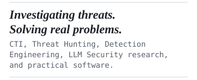</picture>
<picture><source media="(min-width: 1024px)" srcset="./assets/generated/status-desktop.svg">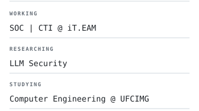</picture>

 

<a href="https://www.linkedin.com/in/santana-iago/"><picture><source media="(min-width: 1024px)" srcset="./assets/generated/contact-linkedin-desktop.svg"></picture></a>&#8195;&#8195;<a href="mailto:iagoss949@gmail.com"><picture><source media="(min-width: 1024px)" srcset="./assets/generated/contact-email-desktop.svg"></picture></a>

<picture><source media="(min-width: 1024px)" srcset="./assets/generated/featured-header-desktop.svg"></picture>

<picture><source media="(min-width: 1024px)" srcset="./assets/generated/featured-card-0-desktop.svg">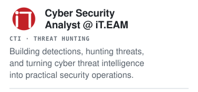</picture><picture><source media="(min-width: 1024px)" srcset="./assets/generated/featured-card-1-desktop.svg">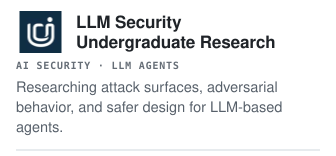</picture><a href="https://criptoescape.com"><picture><source media="(min-width: 1024px)" srcset="./assets/generated/featured-card-2-desktop.svg">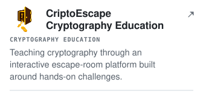</picture></a>

<picture><source media="(min-width: 1024px)" srcset="./assets/generated/current-header-desktop.svg"></picture>

<picture><source media="(min-width: 1024px)" srcset="./assets/generated/current-0-desktop.svg">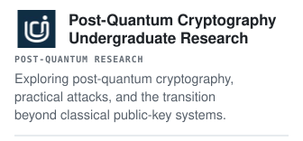</picture><a href="https://github.com/santana-iago/hackatohm"><picture><source media="(min-width: 1024px)" srcset="./assets/generated/current-aptus-desktop.svg">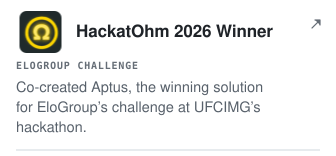</picture></a>

<picture><source media="(min-width: 1024px)" srcset="./assets/generated/current-1-desktop.svg">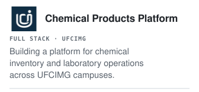</picture><picture><source media="(min-width: 1024px)" srcset="./assets/generated/current-campus-parking-desktop.svg">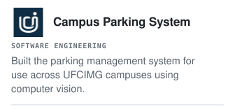</picture>

<picture><source media="(min-width: 1024px)" srcset="./assets/generated/current-2-desktop.svg">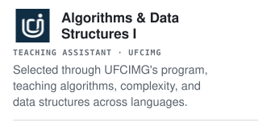</picture><picture><source media="(min-width: 1024px)" srcset="./assets/generated/current-3-desktop.svg">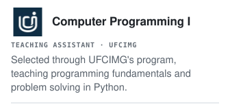</picture>

<picture><source media="(min-width: 1024px)" srcset="./assets/generated/current-6-desktop.svg">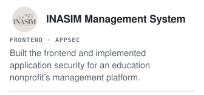</picture><picture><source media="(min-width: 1024px)" srcset="./assets/generated/current-tmb-scan-desktop.svg">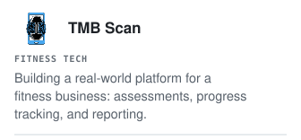</picture>

<a href="https://custodioveiculos.com.br"><picture><source media="(min-width: 1024px)" srcset="./assets/generated/current-5-desktop.svg"></picture></a>

Accessible text version

## Featured work
### Cyber Security Analyst @ iT.EAM
*CTI · THREAT HUNTING*

Building detections, hunting threats, and turning cyber threat intelligence into practical security operations.

### LLM Security Undergraduate Research
*AI SECURITY · LLM AGENTS*

Researching attack surfaces, adversarial behavior, and safer design for LLM-based agents.

### CriptoEscape
*CRYPTOGRAPHY EDUCATION*

Teaching cryptography through an interactive escape-room platform built around hands-on challenges.

## Other work
### Post-Quantum Cryptography Undergraduate Research
*POST-QUANTUM RESEARCH*

Exploring post-quantum cryptography, practical attacks, and the transition beyond classical public-key systems.

### [HackatOhm 2026 Winner](https://github.com/santana-iago/hackatohm)
*ELOGROUP CHALLENGE*

Co-created Aptus, the winning solution for EloGroup’s challenge at UFCIMG’s hackathon.

### Chemical Products Platform
*FULL STACK · UFCIMG*

Building a platform for chemical inventory and laboratory operations across UFCIMG campuses.

### Campus Parking System
*SOFTWARE ENGINEERING*

Built the parking management system for use across UFCIMG campuses using computer vision.

### Algorithms & Data Structures I
*TEACHING ASSISTANT · UFCIMG*

Selected through UFCIMG's program, teaching algorithms, complexity, and data structures across languages.

### Computer Programming I
*TEACHING ASSISTANT · UFCIMG*

Selected through UFCIMG's program, teaching programming fundamentals and problem solving in Python.

### INASIM Management System
*FRONTEND · APPSEC*

Built the frontend and implemented application security for an education nonprofit’s management platform.

### TMB Scan
*FITNESS TECH*

Building a real-world platform for a fitness business: assessments, progress tracking, and reporting.

### [Custódio Veículos](https://custodioveiculos.com.br)
*AUTOMOTIVE SALES*

Building a production platform for a real automotive client: inventory, marketplace publishing, and sales.

<!-- Generated from profile.yml. Edit profile.yml, then run python scripts/build_profile.py. -->
